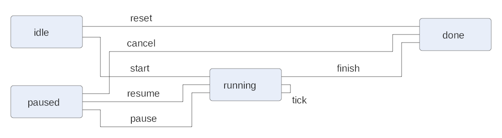
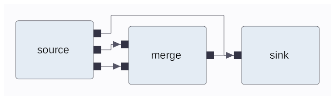
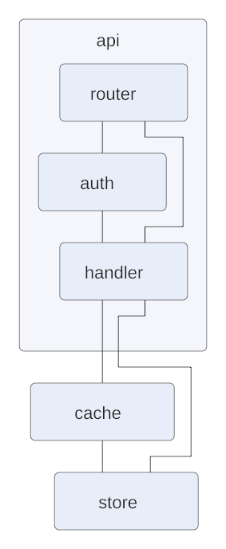
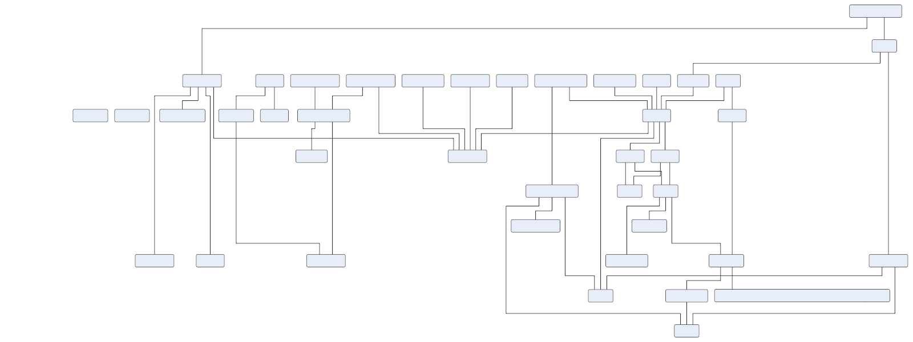
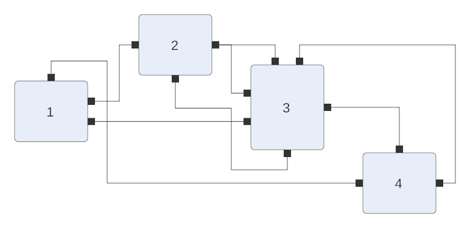
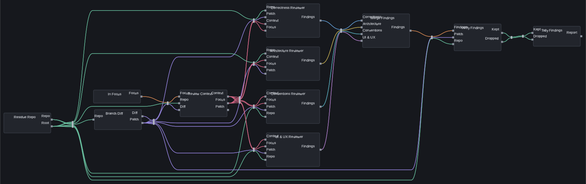

# trellis

Automatic graph layout in Common Lisp. trellis takes a graph with nodes, ports,
labels and edges, and works out where every node goes and how every edge runs.
It reads and writes [ELK](https://eclipse.dev/elk/)'s JSON graph format, so graphs
made for elkjs work unchanged, and it draws results as SVG.

Implements published algorithms directly from the papers,
and is checked against 1,000 graphs that ELK itself laid out
([Conformance](#conformance)). Its only dependency is
[json-simple](https://github.com/modus-lisp/json-simple).

```lisp
(let* ((g (trellis:make-graph :direction :down))
       (a (trellis:add-node g :width 80 :height 30 :labels '("parse")))
       (b (trellis:add-node g :width 80 :height 30 :labels '("check")))
       (c (trellis:add-node g :width 80 :height 30 :labels '("emit"))))
  (trellis:add-edge g a b)
  (trellis:add-edge g b c :labels '("ok"))
  (trellis:add-edge g a c)
  (trellis:layout g)
  (trellis:graph->svg g))        ; => "<svg ..."

(trellis:layout-elk-json "{\"id\":\"root\",\"children\":[...],\"edges\":[...]}")
;; => the same graph as ELK JSON, with positions and edge routes
```

## Examples

| | |
|---|---|
|  |  |
| **states**: edge labels, a self loop, and cycles broken | **ports**: ports fixed to node sides |
|  |  |
| **hierarchy**: a compound node, and edges crossing its border | **modus-lisp**: the org's dependency graph, in partitioned tiers, best of 8 seeds |
|  | |
| **port-sides**: north, south and inverted ports through port dummies | |



**wire-ties**: spline edges, bundled. Edges into the same node converge through a
tie before it, edges out of one node gather at a tie after it. Drawn with the
`:dark` theme, wires coloured by the node they leave.

Each picture's input is the `.json` of the same name in [`examples/`](examples/),
next to its `.svg`. `tools/examples.lisp` regenerates them. The PNGs are drawn by
[stencil](https://github.com/modus-lisp/stencil), which renders SVG in pure Lisp.

## The interface

Everything is in the `trellis` package.

**Graphs.** A graph is its root `node`. Nodes hold child nodes, `port`s, `label`s
and the `edge`s they contain. Coordinates follow ELK:
- A node's `x`/`y` is relative to its parent.
- A port's and a node label's position is relative to its node.
- An edge's route and labels are relative to the node that contains the edge.

| | |
|---|---|
| `(make-graph &rest options)` | a new root node |
| `(add-node parent &key id x y width height labels options)` | a child node; `labels` is a list of strings |
| `(add-port node &key id x y width height side labels options)` | `side` is `:north` `:east` `:south` `:west` |
| `(add-edge parent source target &key id labels options)` | source and target are nodes or ports, anywhere in the hierarchy |
| `(add-label element text &key width height options)` | without a size, one is estimated from the text |
| `(find-element graph id)`, `(map-nodes fn graph)`, `(all-edges graph)` | |
| `(absolute-position element)` | a node's or port's position relative to the root |

Accessors: `node-x`, `node-y`, `node-width`, `node-height`, `node-children`,
`node-ports`, `node-edges`, `node-labels`, `node-parent`, the matching `port-*`
and `label-*` accessors, `edge-sources`, `edge-targets`, `edge-sections`, and
`section-start`, `section-end`, `section-bends` and `section-points`. A route
point is a cons `(x . y)`.
- **Curves.** When `section-curve` is true, the points are cubic Bézier control
  points (start, then control, control, point for each piece), as in ELK's
  spline output. `section-path` samples the curve into a polyline.
- **Ties.** `node-ties` lists the wire ties drawn in a node, each a pair of points.

**Options** are keywords. `(set-option element key value)` and `(option element
key &optional default)` set and read them, and so do the `options` arguments
above. Every ELK option has a keyword, derived mechanically: drop
`org.eclipse.elk.` and the algorithm segment, then turn camelCase and dots into
hyphens.

| ELK | trellis |
|---|---|
| `org.eclipse.elk.direction` | `:direction` |
| `org.eclipse.elk.layered.spacing.edgeEdgeBetweenLayers` | `:spacing-edge-edge-between-layers` |
| `nodeLabels.placement: "[H_CENTER, V_TOP, INSIDE]"` | `:node-labels-placement '(:h-center :v-top :inside)` |
| `portConstraints: "FIXED_SIDE"` | `:port-constraints :fixed-side` |
| `elk.padding: "[top=10,left=10,bottom=10,right=10]"` | a `pad` (from JSON; parsed from the same string) |

`set-option` accepts either form, so `(set-option g "elk.direction" "DOWN")` and
`(set-option g :direction :down)` mean the same. `(describe-option id)` shows the
keyword for an ELK id. Options trellis does not use are kept, and written back
out to JSON.

**Layout.** `(layout graph &rest options)` lays the graph out in place and returns
it. Each compound node is laid out by its `:algorithm`, layered when unset.
`(algorithms)` lists them all.

**ELK JSON.**
- `(read-elk-json source)` reads from a string, pathname or stream.
- `(write-elk-json graph &key stream pretty)` writes the graph back out.
- `(layout-elk-json text &rest options)` does all three steps in one call.

Gson's unquoted `NaN` and `Infinity` are accepted and read as missing.

**Output and checking.**
- `(graph->svg graph &key stream theme)` draws the layout as SVG. `theme` is
  `:light` (the default), or `:dark` with wires coloured by the node they leave.
- `(check-layout graph)` applies the corpus harness's checks and returns counts,
  all zero for a sound layout.
- `(layout-metrics graph)` measures the layout: crossings, bends, edge length,
  area, and edges passing through nodes.

## Algorithms

| `:algorithm` | what it does | after |
|---|---|---|
| `:layered` | flow left to right (or `:direction`); orthogonal, polyline or spline edges | Sugiyama et al. 1981; see below |
| `:mrtree` | tidy trees; other graphs by a spanning forest | Reingold & Tilford 1981 |
| `:radial` | the root at the centre, each level on a circle, subtrees in wedges | Eades 1992 |
| `:force` | spring embedder, `:model` `:fruchterman-reingold` or `:eades` | Fruchterman & Reingold 1991; Eades 1984 |
| `:stress` | stress majorization over shortest-path distances | Gansner, Koren & North 2004 |
| `:disco` | each connected component by force, then packed | |
| `:spore-overlap`, `:spore-compaction` | remove overlaps, and compact, keeping the given positions' order | |
| `:rectpacking`, `:topdownpacking`, `:box` | rows of rectangles; a grid of cells; rows by priority | |
| `:vertiflex` | a tree with nodes held at their `:vertical-constraint` | |
| `:fixed`, `:random` | keep positions; random cells of a grid | |

The algorithms other than layered space nodes out with an overlap-removal pass
that always terminates. They draw edges straight.

### Layered

Each phase follows its paper:

1. **Cycle breaking.** The greedy heuristic of Eades, Lin & Smyth (1993).
   Depth-first is the alternative. Layer constraints and partitions fix some
   edges' direction first.
2. **Layering.** Network simplex (Gansner, Koutsofios, North & Vo 1993):
   - a feasible tree,
   - cut values from the low/lim numbering,
   - exchanges updating only the tree path.

   Partitions are layered in the same problem: between neighbouring
   partitions sits an auxiliary node, which every node of the upper partition
   must precede and every node of the lower one follow. Its edges weigh
   nothing, so edges between partitions still pull their ends together. First
   and last constraints go on top.
3. **Dummy nodes.** Long edges get one dummy per layer they cross. Centre edge
   labels get a dummy node as large as the labels, so a layer makes room for them.
4. **Crossing reduction.** A layer sweep with port-aware barycenters, using the
   node-relative ranks of Schulze, Spönemann & von Hanxleden (2014). Ports whose
   order is free share a rank per side and are sorted afterwards (their
   Algorithm 1). Crossings are counted with the accumulator tree of Barth,
   Jünger & Mutzel (2004). The best of `:thoroughness` runs is kept, then
   improved by sifting (Matuszewski, Schönfeld & Molitor 1999) and a
   greedy-switch pass. Sifting moves each node to its best place in its layer,
   from a table of pairwise crossings. The first run starts from the input
   order, the others from seeded shuffles.
5. **Node placement.** Brandes & Köpf (2001), with the corrections of Brandes,
   Walter & Zink (2020), extended for sizes and ports. Block members carry inner
   shifts, so aligned edges run straight between ports, not node corners. The
   most compact of the four alignments is used; `:fixed-alignment :balanced`
   asks for the balanced combination instead.
6. **Edge routing.** Orthogonal routing with Sander's (2003) segment crossing
   graph, as Weber (2019) describes ELK's use of it:
   - Every edge has at most one vertical segment per gap between layers, and
     edges sharing a port share it (a hypernode).
   - Each pair of hypernodes is compared in both left-to-right orders by the
     crossings each causes; the cheaper order becomes a weighted preference.
   - Pairs that cost the same either way only need different slots. As in
     Sander, and unlike the two-cycles ELK uses, they impose no order.
   - The preferences are made acyclic by Eades' greedy heuristic, and slots
     are assigned in topological order.

   On the corpus this routes with exactly the crossings the node order implies.

**Ports that do not face the flow** follow the global approach of Schulze et
al., Section 4:
- **Inverted ports (4.1).** An edge leaving a west-side port, or entering an
  east-side one, is split by a dummy node in that port's layer. The in-layer
  piece is routed in the gap beside the layer, which gets one before the first
  layer or after the last when needed.
  - Crossing reduction counts the partners' barycenters for each other
    (equation 6).
  - Ports with in-layer edges are ordered so those edges nest (Figure 10).
- **North and south ports (4.2, the fixed-order approach).** These get dummy
  nodes stacked above or below their node, giving the heights the edges turn
  at. An incoming and an outgoing port can share a dummy, with the outermost
  ports on the outermost dummies. The node and its dummies form a layout unit
  that crossing reduction and greedy switching never split.

**Splines** (`:edge-routing :splines`) are built from knots, the points an edge
must pass, each with the direction it passes in:
- ports, left and entered along their normal;
- long-edge dummies, crossed horizontally;
- the turns at port dummies;
- the slot of an in-layer edge.

Every end first runs straight to the edge of its layer's column. Neighbouring
knots are then joined by cubic Béziers whose control points go no further
along each direction than the next knot. So curves bend only in the gaps
between columns, and never through a node.

**Wire ties** (`:wire-ties t`, with splines) bundle edges, after the cable ties
in node editors:
- **Bundles.** Edges entering one node pass through a tie in the gap before it
  and fan out from there to their ports. Edges leaving one node gather at a tie
  in the gap after it.
- **Order.** Inside a tie the wires keep the order of where they come from, so
  they do not cross there.
- **Output.** Each tie is recorded in `node-ties` and drawn as a short band
  across the bundle.

Also handled:
- **Ports:** free, fixed-side, fixed-order and fixed-position constraints.
- **Self loops** run round their node's border.
- **Directions:** all four.
- **Connected components** are laid out separately and packed.
- **`candidates`**: N consecutive seeds, each crossing reduction starting from
  its own shuffle. It keeps the lowest-energy result: the fewest crossings,
  then the shortest total edge length, then the smallest area.

**Hierarchy.** Compound nodes are laid out bottom-up. An edge between different
compound nodes is split along its path through the hierarchy. A temporary port
goes on each compound node it passes, and each level routes its piece like any
other edge. Once a compound node has placed the ports its own layout needed,
the level above keeps them where they are. With `hierarchyHandling
INCLUDE_CHILDREN`, nested compound nodes take the subtree top's layout options
(direction, spacing, strategies) that they do not set themselves.

## Conformance

[`test/corpus`](test/corpus) holds 1,000 random graphs with ELK 0.13's layout of
each. They span all 14 algorithms, with hierarchy, ports, labels, extreme option
values, and injected edge cases such as NaN sizes, negative spacing and huge
nodes. Its [README](test/corpus/README.md) describes how it was made. trellis
runs every case under the same 30-second budget and applies the same checks:
- finite coordinates;
- no overlapping siblings;
- every edge routed, and touching its endpoints;
- children inside their parents.

| | trellis | ELK |
|---|---|---|
| passes every check | **985** | 515 |
| laid out, a check failed | 15 | 381 |
| error | 0 | 96 |
| timeout | 0 | 8 |
| total time | 71 s | 119 s |

Of the 15, 13 are `:fixed` layouts whose given positions overlap, and 2 are
`:fixed` compound nodes inside layered graphs. Fixed keeps positions by design.

Quality is compared only where ELK's own layout passed every check, and only
over the edges ELK routed. For layered graphs:

| layered | trellis | ELK |
|---|---|---|
| total crossings, flat graphs (279) | 141,690 | 158,676 |
| total crossings, hierarchical graphs (20) | 8,709 | 35,733 |
| edges through nodes | 0 | 144 |
| total area, flat graphs | 0.74× | 1 |

The full tables are in [`test/corpus-report.md`](test/corpus-report.md), and every
case's numbers in `test/corpus-results.jsonl`.

```sh
./run-tests.sh          # unit tests, then the corpus (about a minute on SBCL)
./run-tests.sh unit     # unit tests only
```

## Where trellis and ELK differ

- **Port sides.** As in ELK, a declared port side only binds from `FIXED_SIDE`
  constraints up. Below that, ports go where their edges flow.
- **Errors.** ELK signals an error for edges into other compound nodes without
  `INCLUDE_CHILDREN`, for non-trees given to tree algorithms, and for a missing
  target width. trellis routes those edges, draws the tree of a spanning forest,
  and falls back to aspect-ratio packing.
- **Unrouted edges.** ELK leaves edges unrouted under packing, fixed and
  excluded (`noLayout`) layouts. trellis gives them straight routes.
- **Text.** Label sizes are taken as given. A label with no size gets an
  estimate (7 per character by 15), since trellis measures no fonts.

## Layout

```
src/            the library: graph model, options, JSON, micro layout, checks, SVG,
                engine, layered/ (one file per phase), and the other algorithms
test/           unit tests, the corpus runner, the corpus and its latest report
examples/       inputs and their layouts
tools/          examples.lisp
```

MIT licensed.
